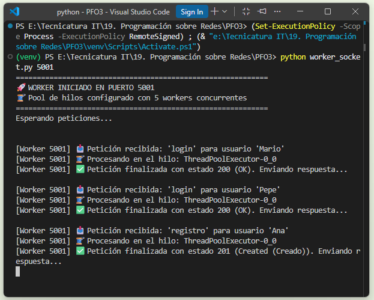
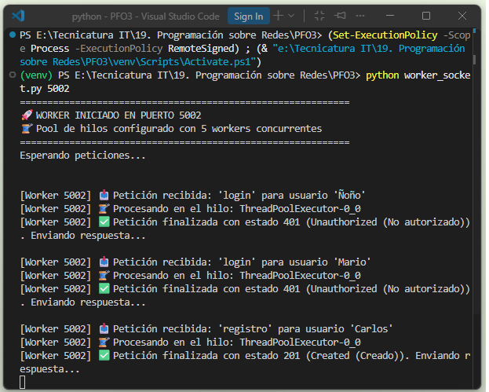
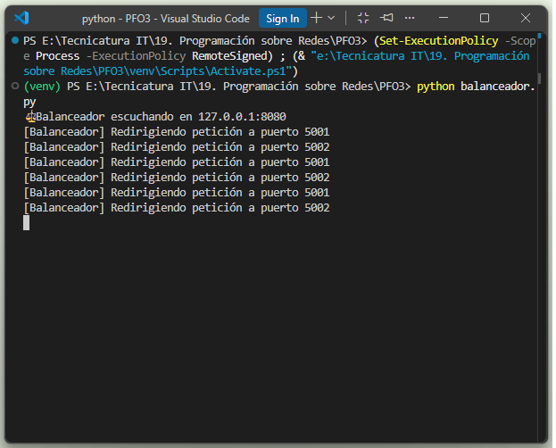
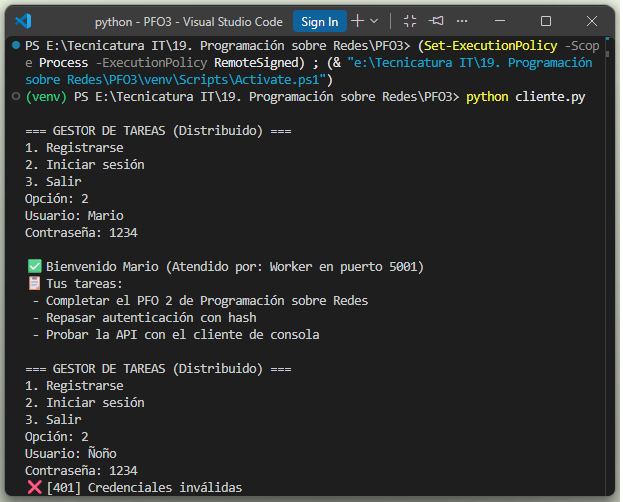
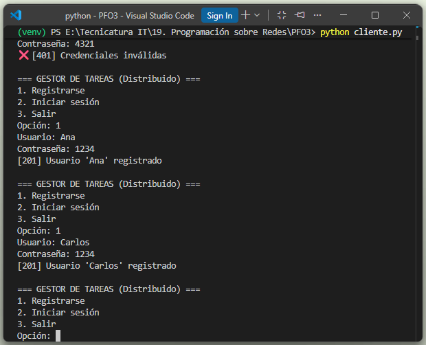

# Programación sobre Redes

## Práctica Formativa Obligatoria 3

## Rediseño como Sistema Distribuido (Cliente-Servidor). Transformar el sistema en una arquitectura distribuida usando sockets.

### ¿Cómo funciona la arquitectura?

**Clientes:** Envían tareas a través de la red usando sockets TCP al puerto 8080.

**Balanceador de Carga:** Actúa como la "puerta de entrada" (similar a Nginx o HAProxy). Utiliza un algoritmo Round Robin (turnos) para repartir equitativamente las peticiones entrantes entre los workers disponibles.

Esto evita que un solo servidor colapse si recibe demasiadas peticiones.

**Servidores Workers:** Cada worker escucha en un puerto distinto (Ej. 5001, 5002). Cuando reciben una tarea, no la procesan en el hilo principal. En su lugar, la delegan a un Pool de Hilos (ThreadPoolExecutor). Esto permite que un worker atienda múltiples tareas en paralelo.

**Cola de Mensajes (Concepto Teórico - RabbitMQ):** En un entorno real, si una tarea es muy pesada, el worker la publica en RabbitMQ. Otro worker "libre" consume el mensaje y lo procesa. Esto se llama comunicación asíncrona. En nuestra implementación local, esto se simula mediante hilos concurrentes para no requerir la instalación de RabbitMQ.

**Almacenamiento (Concepto Teórico - PostgreSQL / S3):** En lugar de usar un único archivo SQLite, los workers consultarían una base de datos centralizada (PostgreSQL) y guardarían archivos pesados (PDFs, imágenes) en un bucket S3.


---

## Instalación

```bash
git clone https://github.com/elavincho/PFO3_Redes.git
cd PFO3_Redes
python -m venv venv
```
## Activar el entorno virtual:

```bash
Windows (PowerShell): .\venv\Scripts\Activate.ps1
```

```bash
Windows (CMD): venv\Scripts\activate.bat
```

```bash
macOS / Linux: source venv/bin/activate
```

## Instalar depencencias:

```bash
pip install flask requests
```

## Ejecución

  **Utilizaremos 4 terminales.**

  **1. Levantar el servidor (worker 1):**

```bash
python worker_socket.py 5001
```



  - El Servidor se inicia en http://127.0.0.1:5001.

**2. Levantar el servidor (worker 2):**

```bash
python worker_socket.py 5002
```



  - El Servidor se inicia en http://127.0.0.1:5002.

  **3. Iniciamos el Balanceador**

```bash
python balanceador.py
```



- Balanceador escuchando en http://127.0.0.1:8080.

**4. Iniciamos el cliente**

```bash
python cliente.py
```






## Parte 2: Rediseño como Sistema Distribuido

Para escalar el sistema y soportar múltiples clientes concurrentes sin que el 
servidor colapse, se rediseñó la arquitectura usando **sockets TCP**, un 
**balanceador de carga** y **servidores workers con pools de hilos**.

### 📊 Arquitectura del Sistema

```mermaid
graph TD
    %% Clientes
    C1[Cliente Móvil] -->|TCP| LB
    C2[Cliente Web] -->|TCP| LB
    C3[Cliente Consola Python] -->|TCP| LB

    %% Balanceador y Servidores Web
    LB[Balanceador de Carga (Nginx/Simulado)] -->|Round Robin| W1
    LB -->|Round Robin| W2
    LB -->|Round Robin| W3

    %% Servidores y Hilos
    subgraph Servidores_Workers [Servidores Workers]
        W1[Worker 1]
        W2[Worker 2]
        W3[Worker 3]
        
        W1 --- T1((Pool de Hilos))
        W2 --- T2((Pool de Hilos))
        W3 --- T3((Pool de Hilos))
    end

    %% Cola de Mensajes
    W1 <-->|Publicar/Consumir| MQ[(Cola de Mensajes - RabbitMQ teórico)]
    W2 <-->|Publicar/Consumir| MQ
    W3 <-->|Publicar/Consumir| MQ

    %% Almacenamiento
    W1 -->|Lectura/Escritura| DB[(PostgreSQL)]
    W2 -->|Lectura/Escritura| DB
    W3 -->|Lectura/Escritura| DB
    
    W1 -->|Archivos| S3[(S3 Bucket)]
    W2 -->|Archivos| S3
    W3 -->|Archivos| S3
```


